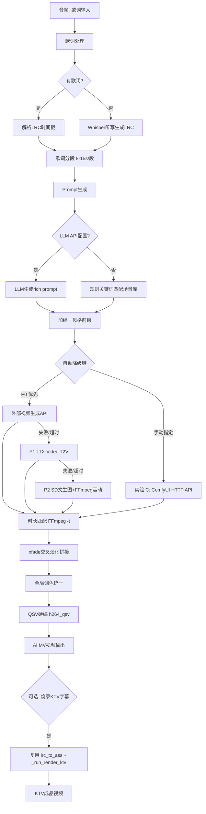

## 产品概述

为卡拉OK工作站新增「根据歌词意境 AI 自动生成视频」功能。用户上传音频（可选歌词文本），系统按歌词时间戳分段，为每段生成匹配意境的低分辨率视频片段，再拼接合成完整视频。最终视频可衔接现有 KTV 字幕烧录流程。

## 核心功能

- 歌词分段：复用现有 LRC 逐词时间戳解析，按意境/时长把歌词分为若干段（每段 8-15 秒）
- 意境转 Prompt：规则提取（关键词匹配预设场景库，无 LLM 依赖，开箱即用）+ 可选外部 LLM API 升级写 prompt
- 三层可插拔视频生成后端（按本次调整优先级）：
- P0 外部视频生成 API：已配置 OpenAI/可灵/即梦等 key 时优先调用，质量最高（云端生成）
- P1 LTX-Video 真文生视频：OpenVINO GenAI 官方支持，本地 Intel iGPU，生成 2-3s 低分辨率片段
- P2 SD/SDXL 文生图 + FFmpeg 运动合成（Ken Burns/zoompan）：本地兜底，保证 100% 出片
- 实验后端 C：ComfyUI HTTP API 桥接（用户自部署，可试 Wan2.1 等非官方模型），手动选择不进自动链
- 自动降级链：P0(API) → P1(LTX-Video) → P2(SD+运动)，前一级失败/超时自动回退下一级
- 连贯性保证：统一风格 prompt 前缀 + 段间 xfade 交叉淡化(0.5-1s) + 全局调色统一
- 时长匹配：按 LRC 时间戳精确控制每段时长，FFmpeg -t 裁剪/循环对齐，总时长 = 歌曲时长
- QSV 硬件编码：拼接/字幕烧录/最终合成走 Intel Quick Sync (h264_qsv)，提速 5-10 倍，带 CPU fallback
- 独立「AI MV 生成」Tab + REST API (/submit/aimv) + SSE 流式 (/stream/aimv)
- 预留超分辨率接口（本期不实现，后续可接 Real-ESRGAN 图级超分）

## 技术栈

- 视频生成：openvino-genai（LTX-Video T2V + SD/SDXL T2I，Intel 官方 GenAI 推理库）
- 外部视频生成 API：HTTP 调用（OpenAI/可灵/即梦，可配置 provider + api_key + base_url）
- 运动合成/拼接/编码：FFmpeg（zoompan Ken Burns + xfade 交叉淡化 + h264_qsv 硬编）
- Prompt 生成：规则关键词匹配（内置场景库）+ 可选外部 LLM HTTP API（注意：写 prompt 的 LLM 与生成视频的 API 是两套独立配置）
- ComfyUI 桥接：HTTP API（/prompt 提交 + /history 轮询）
- UI/API：复用现有 Gradio + FastAPI SSE 框架
- 模型管理：复用现有 huggingface_hub + 持久化 pref 文件模式

## 实现方案

### 核心策略：三层可插拔后端 + 自动降级链（API → LTX-Video → SD+运动）

经核实，OpenVINO GenAI 官方仅支持 LTX-Video 一个视频生成模型；Wan2.1/CogVideoX/SVD 均无官方 OpenVINO 适配。结合用户本次调整，采用如下优先级确保 Intel 集显环境下 100% 可出片：

1. **P0 外部视频生成 API（最高优先级）**：config 中若配置了有效 provider+api_key，则优先调用云端视频生成接口，每段返回视频片段。质量最高、速度最快，但非本地生成。需处理不同厂商的请求/响应格式差异（用 provider 分发）。
2. **P1 LTX-Video 真 T2V（本地优先）**：openvino.genai Text2Video 生成 2-3s 低分辨率(512x320) 视频片段。iGPU 上每段 5-15 分钟，适合短歌或关键段落。失败/超时自动降级到 P2。
3. **P2 SD+运动合成（本地兜底）**：openvino.genai Text2Image 生成关键帧 → FFmpeg zoompan 平移缩放 + 淡入淡出 → 视频片段。SD1.5 在 iGPU 上 5-15s/张，一首 4 分钟歌（约 20 段）总耗时 5-15 分钟。这是无 API/LTX 时的实际默认路径。
4. **实验后端 C（ComfyUI 桥接）**：用户自部署 ComfyUI+OpenVINO，本项目通过 HTTP API 调用，可试 Wan2.1 等非官方模型。仅当用户在 UI 手动选中时启用，不进入自动降级链。

降级编排在 `generate_aimv` 生成器中实现：遍历 [API, LTX-Video, SD+运动] 链，对单段 try 调用某后端 generate_clip，抛异常则 mark 该后端失败并切下一级，整段处理记录实际使用的后端，逐级回退直至 P2 保证出片。

### 性能考量

- **LTX-Video 瓶颈**：iGPU 上每段 5-15 分钟，UI 须明确提示预计耗时；默认不自动选 LTX，需用户/降级触发
- **SD+运动优势**：SD1.5 在 iGPU 上 5-15s/张，FFmpeg 运动合成几乎瞬时
- **内存**：Docker 24G 限制。LTX-Video 模型约 5-8GB，SD1.5 约 4GB，均使用 iGPU 共享内存。生成串行（不并行），避免 OOM
- **QSV 编码**：启动时检测一次 `ffmpeg -encoders | grep h264_qsv` 缓存到 `HAS_QSV`，不可用时 fallback 到 libx264。字幕滤镜 (-vf subtitles) 仍走 CPU，编码走 GPU，兼容无碍

### 连贯性策略

- 所有 prompt 强制统一风格前缀（如 `cinematic, dreamy atmosphere, soft pastel colors, consistent art style`）
- 相邻段使用相近 seed，保持视觉延续
- 段间 xfade 交叉淡化 0.5-1 秒，消除硬切
- 最后统一调色 pass（FFmpeg colorbalance/eq），统一色调

### 时长匹配策略

- 复用 `_parse_word_lrc` 拿到每行起止时间戳
- 按时长分组合并相邻短行为一段（目标 8-15 秒/段）
- 每段目标时长 = 该段末行结束时间 - 首行开始时间
- SD+运动：FFmpeg `-t {duration}` + zoompan 精确控制输出时长
- LTX-Video：生成 2-3s 片段后用 FFmpeg loop/setpts 延长或 trim 裁剪到目标时长
- xfade 拼接吃掉 overlap 时长，分段时预留 0.5-1 秒 overlap

## 实现注意事项

- **复用现有模式**：生成器 yield 进度（同 processing.py/video_processing.py）、模型后台加载（同 model_loader.py threading.Event）、模型下载缓存（同 model_manager.py huggingface_hub + .files 标记）、SSE 框架（同 api.py `_sse`/`_create_stream_job`）
- **QSV 检测**：启动时检测一次缓存结果，config.py 加 `HAS_QSV` 全局变量，避免每次调用都探测
- **模型加载**：LTX-Video/SD 模型首次使用按需下载（同 Whisper 模式），后台线程加载 + Event 就绪信号。UI 状态栏显示 T2V 后端/模型状态
- **爆炸半径控制**：QSV 改造 `_run_render_ktv` 时保留 libx264 fallback，`HAS_QSV=False` 时行为完全不变，不影响现有 MV 转 KTV 功能
- **日志**：复用 print + flush 模式，FFmpeg 子进程 stdout 解析进度（同 `_run_demucs`/`_run_render_ktv`），错误取 stderr 尾部 500 字符，避免输出大 payload
- **输出目录**：所有产物写入 config.OUTPUT_DIR，命名 `{base_name}_seg{N}.mp4` / `{base_name}_keyframe{N}.png` / `{base_name}_aimv.mp4`

## 架构设计



## 目录结构

```
karaoke-convert/
├── config.py              # [MODIFY] 新增 T2V 后端优先级链配置、外部视频API配置(provider/key/base_url)、
│                          #          QSV 编码器检测(HAS_QSV)、风格预设库、场景关键词库、LLM 写prompt API key、
│                          #          LTX-Video/SD 模型路径与默认选择
├── video_generation.py    # [NEW] AI 视频生成核心模块。歌词分段(group_lyric_segments)、Prompt 生成
│                          #        (generate_prompt 规则+LLM)、四后端(APIBackend/LTXVideoBackend/
│                          #        SDMotionBackend/ComfyUIBackend)、自动降级链编排、片段拼接
│                          #        (concat_with_xfade)、时长匹配(match_duration)、全局调色、主编排器 generate_aimv
├── video_processing.py    # [MODIFY] _run_render_ktv 的 libx264 改为 h264_qsv(带 fallback)，新增 _detect_qsv() 检测函数
├── app.py                 # [MODIFY] 新增「AI MV 生成」Tab(音频+歌词输入+后端选择+风格选择+输出视频+状态)，
│                          #          状态栏 get_status_html 加 T2V 后端/模型信息
├── api.py                 # [MODIFY] 新增 POST /submit/aimv(轮询) + POST /stream/aimv(SSE)，照搬现有框架
├── model_manager.py       # [MODIFY] 新增 LTX-Video/SD 模型的下载/缓存检测/删除/切换(参考 download_whisper_model)
├── dockerfile             # [MODIFY] Layer3 pip install 加 openvino-genai；Layer4 COPY 加 video_generation.py
└── docker-compose.yaml    # [MODIFY] volumes 加 ./model_cache/openvino:/root/.cache/openvino(OpenVINO 模型缓存)
```

## 关键代码结构

```python
# video_generation.py - 核心数据结构与后端接口

from dataclasses import dataclass

@dataclass
class LyricSegment:
    """歌词分段数据"""
    index: int
    start_time: float       # 秒，该段起始时间戳
    end_time: float         # 秒，该段结束时间戳
    duration: float         # end - start
    text: str               # 该段歌词文本
    prompt: str             # 生成的画面描述 prompt
    clip_path: str | None = None  # 生成的视频片段路径


class VideoBackend:
    """可插拔视频生成后端接口"""
    name: str = "base"
    def generate_clip(self, segment: LyricSegment, output_path: str,
                      style_prefix: str, resolution: tuple[int, int]) -> str:
        """生成单个视频片段，返回路径；失败抛异常触发降级"""
        ...

# 四个实现：
# class APIBackend(VideoBackend):        # P0 外部视频生成 API（OpenAI/可灵/即梦，provider 分发）
# class LTXVideoBackend(VideoBackend):   # P1 openvino.genai Text2Video，2-3s 片段
# class SDMotionBackend(VideoBackend):   # P2 openvino.genai Text2Image + FFmpeg zoompan
# class ComfyUIBackend(VideoBackend):    # 实验 C HTTP POST /prompt + 轮询 /history
```

## Agent Extensions

### Skill

- **多模态内容生成**
- Purpose: 在开发阶段用于验证 Prompt 工程质量——用不同歌词意境生成参考视频/图片，对比评估本地 OpenVINO 输出的质量差距，优化场景关键词库和风格前缀
- Expected outcome: 产出一组高质量参考素材，指导规则提取场景库的关键词映射调优，确保本地 SD+运动合成产出的画面意境与歌词匹配度达标