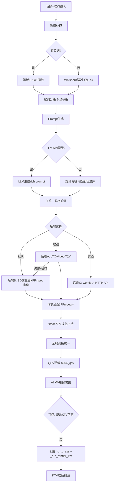

## 产品概述

为卡拉OK工作站新增「根据歌词意境AI自动生成视频」功能。用户上传音频（可选歌词文本），系统按歌词时间戳分段，为每段生成匹配意境的低分辨率视频片段，再拼接成完整视频。最终视频可与现有KTV字幕烧录流程衔接。

## 核心功能

- 歌词分段：复用现有LRC逐词时间戳解析，按意境/时长将歌词分为若干段（每段8-15秒）
- 意境转Prompt：规则提取（关键词匹配预设场景库，无LLM依赖，开箱即用）+ 可选外部LLM API升级
- 三层可插拔视频生成后端：
- 默认后端：SD/SDXL文生图(OpenVINO) + FFmpeg运动合成（Ken Burns/zoompan），快速可靠，一首4分钟歌约5-15分钟
- 增强后端：LTX-Video真文生视频(OpenVINO GenAI官方支持)，质量更高但慢（每段5-15分钟，适合短歌或关键段落）
- 实验后端：ComfyUI HTTP API桥接（用户自部署，可试Wan2.1等非官方模型）
- 自动降级：LTX-Video失败/超时自动回退到SD+运动
- 连贯性保证：统一风格prompt前缀 + 段间xfade交叉淡化(0.5-1s) + 全局调色统一
- 时长匹配：按LRC时间戳精确控制每段时长，FFmpeg -t裁剪/循环对齐，总时长=歌曲时长
- QSV硬件编码：视频拼接/字幕烧录/最终合成全部走Intel Quick Sync(h264_qsv)，提速5-10倍，带CPU fallback
- 独立「AI MV生成」Tab + REST API(/submit/aimv) + SSE流式(/stream/aimv)
- 预留超分辨率接口（本期不实现，后续可接Real-ESRGAN图级超分）

## Tech Stack

- 视频生成：openvino-genai（LTX-Video T2V + SD/SDXL T2I，Intel官方GenAI推理库）
- 运动合成/拼接/编码：FFmpeg（zoompan Ken Burns + xfade交叉淡化 + h264_qsv硬编）
- Prompt生成：规则关键词匹配（内置）+ 可选外部LLM HTTP API
- ComfyUI桥接：HTTP API（/prompt + /history轮询）
- UI/API：复用现有 Gradio + FastAPI SSE 框架
- 模型管理：复用现有 huggingface_hub + 持久化pref文件模式

## Implementation Approach

### 核心策略：三层可插拔后端 + 自动降级

经核实，OpenVINO GenAI官方仅支持LTX-Video一个视频生成模型。Wan2.1/CogVideoX/SVD均无官方OpenVINO适配。因此采用三层架构确保Intel集显环境下100%可出片：

1. **默认后端B（SD+运动合成）**：openvino.genai Text2Image生成关键帧 → FFmpeg zoompan平移缩放+淡入淡出 → 视频片段。每段约10-30秒（图片生成5-15s + FFmpeg瞬间），一首4分钟歌（约20段）总耗时5-15分钟。**这是实际默认路径**。
2. **增强后端A（LTX-Video真T2V）**：openvino.genai Text2Video生成2-3s低分辨率(512x320)视频片段。每段5-15分钟，适合短歌或用户选择的关键段落。失败/超时自动降级到B。
3. **实验后端C（ComfyUI桥接）**：用户自部署ComfyUI+OpenVINO，本项目通过HTTP API调用。可试Wan2.1等非官方模型，成功就用真视频，失败回退B。

### 性能考量

- **LTX-Video瓶颈**：iGPU上每段5-15分钟，20段=100-300分钟。UI须明确提示预计耗时，默认不选LTX-Video
- **SD+运动优势**：SD1.5在iGPU上5-15s/张，20段关键帧=2-5分钟 + FFmpeg运动合成几乎瞬间
- **内存**：Docker 24G限制。LTX-Video模型约5-8GB，SD1.5约4GB，均使用iGPU共享内存。生成时串行（不并行），避免OOM
- **QSV编码**：检测h264_qsv编码器可用性（`ffmpeg -encoders | grep h264_qsv`），不可用时fallback到libx264。字幕滤镜(-vf subtitles)仍走CPU，编码走GPU，兼容无问题

### 连贯性策略

- 所有prompt强制统一风格前缀（如`cinematic, dreamy atmosphere, soft pastel colors, consistent art style`）
- 相邻段使用相近seed，保持视觉延续
- 段间xfade交叉淡化0.5-1秒，消除硬切
- 最后统一调色pass（FFmpeg colorbalance/eq），统一色调

### 时长匹配策略

- 复用`_parse_word_lrc`拿到每行起止时间戳
- 按时长分组合并相邻短行为一段（目标8-15秒/段）
- 每段目标时长=该段末行结束时间-首行开始时间
- SD+运动：FFmpeg `-t {duration}` + zoompan精确控制输出时长
- LTX-Video：生成2-3s片段后用FFmpeg loop/setpts延长或trim裁剪到目标时长
- xfade拼接会吃掉overlap时长，分段时预留0.5-1秒overlap

## Implementation Notes

- **复用现有模式**：生成器yield进度（同processing.py/video_processing.py）、模型后台加载（同model_loader.py threading.Event）、模型下载缓存（同model_manager.py huggingface_hub + .files标记）、SSE框架（同api.py _sse/_create_stream_job）
- **QSV检测**：启动时检测一次缓存结果，避免每次调用都探测。config.py加`HAS_QSV`全局变量
- **模型加载**：LTX-Video/SD模型首次使用按需下载（同Whisper模式），后台线程加载+Event就绪信号。UI状态栏显示T2V后端/模型状态
- **Blast radius**：QSV改造_run_render_ktv时保留libx264 fallback，`HAS_QSV=False`时行为完全不变，不影响现有MV转KTV功能
- **日志**：复用print+flush模式，FFmpeg子进程stdout解析进度（同_run_demucs/_run_render_ktv）。避免输出大payload，错误取stderr尾部500字符
- **输出目录**：所有产物写入config.OUTPUT_DIR，命名`{base_name}_seg{N}.mp4`/`{base_name}_keyframe{N}.png`/`{base_name}_aimv.mp4`

## Architecture Design



## Directory Structure

```
karaoke-convert/
├── config.py              # [MODIFY] 新增T2V后端配置、QSV编码器检测(HAS_QSV)、风格预设库、场景关键词库、LLM API key配置、LTX-Video/SD模型路径
├── video_generation.py    # [NEW] AI视频生成核心模块。包含：歌词分段(group_lyric_segments)、Prompt生成(generate_prompt规则+LLM)、三层后端(LTXVideoBackend/SDMotionBackend/ComfyUIBackend)、片段拼接(concat_with_xfade)、时长匹配(match_duration)、主编排器(generate_aimv生成器)
├── video_processing.py    # [MODIFY] _run_render_ktv的libx264改为h264_qsv(带fallback)，新增_detect_qsv()检测函数
├── app.py                 # [MODIFY] 新增"AI MV生成"Tab(音频+歌词输入+后端选择+风格选择+输出视频+状态)，状态栏get_status_html加T2V信息
├── api.py                 # [MODIFY] 新增POST /submit/aimv(轮询) + POST /stream/aimv(SSE)，照搬现有_start_job/_create_stream_job/_sse模式
├── model_manager.py       # [MODIFY] 新增LTX-Video/SD模型的下载/缓存检测/删除/切换(参考现有download_whisper_model模式)
├── dockerfile             # [MODIFY] Layer3 pip install加openvino-genai；Layer4 COPY加video_generation.py
└── docker-compose.yaml    # [MODIFY] volumes加./model_cache/openvino:/root/.cache/openvino(OpenVINO模型缓存)
```

## Key Code Structures

```python
# video_generation.py - 核心数据结构与后端接口

from dataclasses import dataclass

@dataclass
class LyricSegment:
    """歌词分段数据"""
    index: int
    start_time: float       # 秒，该段起始时间戳
    end_time: float         # 秒，该段结束时间戳
    duration: float         # end - start
    text: str               # 该段歌词文本
    prompt: str             # 生成的画面描述prompt
    clip_path: str | None = None  # 生成的视频片段路径


class VideoBackend:
    """可插拔视频生成后端接口"""
    def generate_clip(self, segment: LyricSegment, output_path: str,
                      style_prefix: str, resolution: tuple[int, int]) -> str:
        """生成单个视频片段，返回路径；失败抛异常触发降级"""
        ...

# 三个实现：
# class LTXVideoBackend(VideoBackend):   # openvino.genai Text2Video，2-3s片段
# class SDMotionBackend(VideoBackend):   # openvino.genai Text2Image + FFmpeg zoompan
# class ComfyUIBackend(VideoBackend):    # HTTP POST /prompt + 轮询 /history
```

## Agent Extensions

### Skill

- **多模态内容生成**
- Purpose: 在开发阶段用于验证Prompt工程质量——用不同歌词意境生成参考视频/图片，对比评估本地OpenVINO输出的质量差距，优化场景关键词库和风格前缀
- Expected outcome: 产出一组高质量参考素材，指导规则提取场景库的关键词映射调优，确保本地SD+运动合成产出的画面意境与歌词匹配度达标